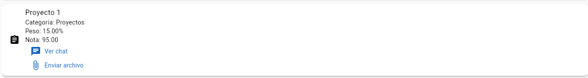

# Matriz de mejoras — DeclaraUCR

**Proyecto 2 · IF0009 · UCR Sede del Sur**

La matriz sigue la estructura del descriptor (§4): **observación → acción → prioridad → evidencia → estado**.
Se le agregan dos columnas que el descriptor exige para los pendientes: **origen** y **justificación /
propuesta de atención**.

- **Prioridad:** Alta (impide completar un proceso, compromete datos o permite accesos indebidos; se corrige
  antes de las pruebas con usuarios, §4), Media, Baja.
- **Estado:** Pendiente, En proceso, Verificada.
- **Evidencia:** commit, prueba (automatizada o caso CP-xx) o captura con nombre de archivo.

## 1. Versión base del Proyecto 1

| | |
|---|---|
| Repositorio | DeclaraHorario (sistema web del Proyecto 1) |
| Versión base | `main` en `2661da2` (merge del PR #94, 10/11/2026), lo entregado en el Proyecto 1 |
| Etiqueta | [`p1-entrega`](https://github.com/dayanachavarriasteller-maker/DeclaraHorario/releases/tag/p1-entrega) en DeclaraHorario, sobre `2661da2` |
| Retroalimentación recibida | Nota **95** (peso 15 %), captura en [`retroalimentacion-p1.png`](retroalimentacion-p1.png). Comentario del docente, de palabra: el sistema estaba muy bien y solo quedaban detalles pequeños. Pidió un cambio concreto: el nombre del rol **«revisor» no es reconocible** para las personas usuarias (fila P1-03) |

La app móvil usa el backend de esa versión: las reglas copiadas en `backend/proyecto1/` vienen del commit
`5f68958` de DeclaraHorario (ver `backend/proyecto1/ORIGEN.txt`).

## 2. Observaciones de la revisión del Proyecto 1

La evaluación del Proyecto 1 dejó **una observación del docente** (P1-03, el nombre del rol). Además, el
equipo revisó por su cuenta la versión base y registra lo que encontró (P1-01 y P1-02). Solo se anotan puntos
reales y comprobables; no se inventan observaciones.

| # | Origen | Observación | Acción concreta | Prioridad | Evidencia | Estado |
|---|---|---|---|---|---|---|
| P1-01 | Revisión del equipo | El sistema solo se usaba desde la computadora; la persona declarante no podía llenar ni firmar desde el teléfono | Módulo móvil con los tres procesos y la firma de la declarante, sobre el mismo backend | Alta | Este proyecto: release v2.0.0+7; CP-01 a CP-07 (`entregables/05-informe-pruebas/pruebas-tecnicas.md`) | Verificada |
| P1-02 | Revisión del equipo | El estado `VALIDADA` lo decide el cliente; las reglas validan formato y permisos, no recalculan horas | Pendiente con justificación: requiere una Cloud Function (plan Blaze de Firebase). Propuesta: función que recalcule horas y traslapes y rechace un `VALIDADA` inválido | Media | Informe técnico §8; `entregables/02-aplicacion-distribuible/instalacion.md` §7 | Pendiente con justificación |
| P1-03 | Docente (evaluación del P1, de palabra) | El rol que firma después de la persona declarante se llamaba «Revisor», un nombre que las personas usuarias no reconocen | Llamarlo **«Superior»** en toda la app: estados («Pendiente de firma del superior»), seguimiento, botón «Firmar y enviar a mi superior», avisos y PDF de la declaración. En los datos ya se llamaba `superior`, así que no cambia el backend | Media | Textos en `lib/` y pruebas actualizadas (`declaration_progress_test`, `widget_test`, `proyecto1_write_test`); release v2.0.0+8 (APK de `abc5818`, PR #34) | Verificada |

## 3. Observaciones de la socialización

> Se llenan después de la socialización (§9), con lo que se recoja en el formulario (`06-socializacion/`) y lo
> que diga el docente en los 10 minutos de preguntas. Cada fila se marca **Aceptada**, **Parcialmente
> aceptada** o **Descartada**, siempre con justificación. Hay que implementar **al menos dos** mejoras; si hay
> menos de dos acciones pertinentes, se atienden todas y se explica por qué.

| # | Quién la hizo | Observación | Decisión | Acción concreta | Prioridad | Evidencia | Estado | Justificación |
|---|---|---|---|---|---|---|---|---|
| S-01 | `[Docente / Equipo X]` | | | | | | | |
| S-02 | | | | | | | | |
| S-03 | | | | | | | | |
| S-04 | | | | | | | | |

## 4. Otras mejoras registradas durante el Proyecto 2

No vienen de la revisión ni de la socialización, sino de las pruebas propias. Se registran aquí para que la
trazabilidad quede completa.

| # | Origen | Observación | Acción | Prioridad | Evidencia | Estado |
|---|---|---|---|---|---|---|
| T-01 | Prueba en teléfono (2.0.0+3) | Un período cerrado en la web seguía apareciendo al crear una declaración | Leer los períodos del servidor, no de la copia del teléfono | Alta | Commit `0be0200`; prueba "a period closed after a first read is no longer offered" | Verificada |
| T-02 | Prueba en teléfono (2.0.0+3) | La sección de cursos aparecía dos veces | Mostrarla una sola vez | Media | Commit `ef42e47` | Verificada |
| T-03 | Prueba en teléfono (2.0.0+3) | La vista previa del PDF no permitía acercar | Zoom con pellizco y doble toque | Media | Commit `4d3184f` | Verificada |
| T-04 | Prueba en teléfono (2.0.0+5) | Con la letra del sistema al 110 % se cortaban palabras en el seguimiento | Etiquetas que nunca parten una palabra | Media | Commit `f633fb8`; `entregables/07-guia-uso/capturas/01-inicio.png` | Verificada |
| T-05 | Recorrido 20/11/2026 (D-01) | Salir con Atrás perdía los cambios sin avisar | Diálogo "¿Salir sin guardar?" | Alta | Prueba "leaving with unsaved changes asks first (D-01)"; `05-informe-pruebas/capturas/D-01-*.png`; commit `afeb1ee` (PR #8) | Verificada |
| T-06 | Recorrido 20/11/2026 (D-02) | La cuadrícula no se podía usar con TalkBack | Cada media hora es un botón con día, hora y contenido | Alta | Prueba "with TalkBack, each half hour says what it has and places (D-02)"; commit `afeb1ee` (PR #8) | Verificada (falta repetirla en el teléfono) |
| T-07 | Recorrido 20/11/2026 (D-03) | Chips de horas leídos como casillas | Leerlos como texto | Baja | `lib/screens/home_screen.dart` (`_HoursChip`); commit `afeb1ee` (PR #8) | Verificada |
| T-08 | Ensayo de las sesiones 21/11/2026 (2.0.0+7) | Después de guardar un borrador existente, la lista de declaraciones sigue mostrando las horas anteriores hasta reiniciar la app (lo guardado en el servidor sí es correcto) | Que la lista se actualice al guardar (`watchAll` en `proyecto1_declaration_repository.dart`). Con el SDK real de Firestore y las reglas del P1 (emulador Android) la lista ya se actualiza; no se reprodujo el fallo. Queda una prueba de integración que lo vigila | Media | `integration_test/release_8_rules_test.dart` pasa, 27/11/2026; release v2.0.0+8 (APK de `abc5818`, PR #34) | Verificada en emulador (falta confirmarla en el teléfono, retest §6.7) |
| T-09 | Prueba de integración 27/11/2026 (2.0.0+8) | Al guardar el primer borrador, la lista lo recibe antes de que el servidor confirme la escritura; leer su versión del servidor da `PERMISSION_DENIED` (la regla busca la declaración, que aún no existe) y la lista se salta el borrador un instante | Si la declaración aún no está confirmada, su versión se lee de la copia del teléfono. La prueba de integración falla si la lista se salta una declaración, y cubre guardar sin conexión | Media | `integration_test/release_8_rules_test.dart` (falla sin el cambio, pasa con él); commit `096dcbd` (PR #35); release v2.0.0+9 | Verificada |
| U-01 | Sesión P1, 24/11/2026 (T1) | La persona no sabía cómo empezar la declaración (nunca había hecho una) | Cubierta por U-06: el recorrido de primer uso explica cómo empezar (paso 1, «Inicio») | Baja | Prueba "the tour shows once on a new phone…"; release v2.0.0+8 (APK de `abc5818`, PR #34) | Verificada |
| U-02 | Sesión P1, 24/11/2026 (formulario) | La lista de **Puesto** deja elegir cualquier puesto, aunque no sea el de la persona | **Descartada por ahora, con justificación:** la app no tiene una fuente del puesto real de la persona (no lo registra la Coordinación ni Administración en el P1). Propuesta: que Administración asigne el puesto en la web y la app lo muestre fijo, como los cursos | Media | Respuesta de P1 en el formulario; informe de pruebas §6.6 | Pendiente con justificación |
| U-03 | Sesión P2, 24/11/2026 (T1–T2) | No sabía cómo tocar los cuadros para asignar horas en la cuadrícula | Encima de la cuadrícula se ve siempre qué se ubica con cada toque, con su color y pasos numerados («1. Elija qué va a ubicar», «2. Toque el horario para ubicar: …») | Alta | Prueba "the grid always says what a tap places (U-03)"; release v2.0.0+8 (APK de `abc5818`, PR #34) | Verificada |
| U-04 | Sesión P2, 24/11/2026 (T1) | Después de Validar no vio el botón «Firmar y enviar a mi superior» | Después de Validar, el botón principal del resumen pasa a ser **Firmar y enviar** y un aviso dice que firmar es el siguiente paso | Media | Prueba "a validated declaration offers signing… (U-04)"; release v2.0.0+8 (APK de `abc5818`, PR #34) | Verificada |
| U-05 | Sesión P2, 24/11/2026 (T1) | Después de Validar, Atrás lo devolvió al editor y la declaración volvió a Borrador | Atrás después de validar vuelve al inicio; solo «Corregir» abre el editor. El editor ya no guarda como borrador una declaración validada sin cambios | Media | Prueba "Back after validating goes to the start… (U-05)"; release v2.0.0+8 (APK de `abc5818`, PR #34) | Verificada |
| U-06 | Sesiones P1 y P2, 24/11/2026 | Falta un tutorial la primera vez que explique cada parte | Recorrido guiado la primera vez en el teléfono, y desde el perfil en «Cómo funciona». En la 2.0.0+8 eran 4 páginas fijas; el equipo lo encontró demasiado básico y en la **2.0.0+9** recorre las pantallas reales con una docente ficticia: enfoca una parte a la vez (el resto se oscurece y desenfoca), dice para qué sirve y qué va en cada campo, y avanza al tocar («Toque para continuar»). Cubre Inicio, Declaraciones, el formulario, el horario, el resumen, Zonaje e Historial (24 pasos); no guarda nada | Media | Prueba "the tour shows once on a new phone, then from the profile (U-06)" (recorre los 24 pasos y falla si uno no encuentra su parte) y "the tour teacher has a complete, valid declaration"; revisado en el emulador Android; release v2.0.0+9 | Verificada |
| U-07 | Sesión P2, 24/11/2026 | El perfil no deja editar el nombre ni la cédula | Editar nombre, cédula (9 dígitos, se reserva la nueva) y teléfono desde el perfil; las declaraciones ya firmadas conservan sus datos. Correo, sede y carrera siguen con Administración | Media | Pruebas "editing the own profile (U-07)" y "the person corrects name, cédula and phone (U-07)"; reglas del P1 en `integration_test/release_8_rules_test.dart`; release v2.0.0+8 (APK de `abc5818`, PR #34) | Verificada |
| U-08 | Sesión P3, 27/11/2026 (docente, después de las tareas) | Pidió «lo del párrafo de declaración»: el juramento predeterminado era un texto personalizado («Yo, {nombre}…»), distinto del formulario oficial de la Universidad. Entregó al equipo el Excel con el machote oficial | El juramento predeterminado es el del formulario oficial, palabra por palabra. Una declaración firmada conserva el texto que la persona aceptó, y la plantilla que Administración guarde en `config/oath` sigue mandando. Mientras esa plantilla no exista, la web del P1 muestra antes de firmar su propio texto predeterminado | Media | Prueba "before signing, the oath is the one of the official form"; commit `372d224`; release v2.0.0+10 (APK de `60d5813`, PR #37) | Verificada |
| U-09 | Sesión P3, 27/11/2026 (T2) | «Como es celular se me perdía el tema de las horas de clase […] no sabía qué día ni qué hora me asignaron las HC»: en el horario, las clases solo se veían abriendo cada día | Arriba de los días, la tarjeta **Horario de sus clases** muestra cada curso con los días y horas de sus clases, como información para guiarse; tocar uno abre ese día. Se quitó la línea de ayuda debajo de la tarea elegida (mantener presionado y deslizar lo explican el recorrido y la guía) | Media | Pruebas "the lessons of each course are listed above the days" y "a long press and slide places several half hours"; commit `4c913e6`; release v2.0.0+10 (APK de `60d5813`, PR #37) | Verificada |

## 5. Resumen

- **Revisión del P1:** 1 observación del docente (P1-03, verificada en la 2.0.0+8) y 2 de la revisión del
  equipo (1 verificada, 1 pendiente con justificación: P1-02 necesita una Cloud Function).
- **Pruebas propias del Proyecto 2:** 9 (todas verificadas; T-08 en emulador, falta confirmarla en el teléfono).
- **Sesiones con usuarios:** 9 hallazgos: 7 de P1 y P2 y 2 de P3 (docente). 8 verificados: U-01 y U-03 a U-07 en
  la 2.0.0+8 (el recorrido de U-06 se rehízo en la 2.0.0+9 y P3 hizo las tareas sin ayuda con él), U-08 y U-09 en
  la 2.0.0+10; 1 pendiente con justificación (U-02).
- **Socialización:** `[COMPLETAR al cierre: __ observaciones (__ aceptadas, __ parcialmente, __ descartadas);
  __ mejoras implementadas]`.

## Anexo: evaluación del Proyecto 1

