# Informe de pruebas — DeclaraUCR

**Proyecto 2 · IF0009 Desarrollo de Software IV · UCR Sede del Sur**
Aplicación móvil del Sistema de Declaraciones Juradas de Horario y Jornada de Trabajo.

Este informe junta las tres capas de prueba que pide el descriptor (§7 y §8): los casos técnicos ejecutados en
el teléfono, las pruebas automatizadas sobre las reglas de mayor riesgo y las sesiones con personas usuarias.
Cada hallazgo termina en una corrección y una nueva comprobación, o en una justificación de por qué no se
corrigió.

> **Marcas para completar.** Lo que dice `[COMPLETAR]` depende de algo que solo el equipo puede hacer (una
> sesión con una persona, una prueba en otro teléfono). Todo lo demás ya está ejecutado y tiene evidencia.

---

## 1. Versiones evaluadas

| Versión | Commit | Dónde se usó |
|---|---|---|
| 2.0.0+5 | `fc21a84` | Casos técnicos CP-01 a CP-07 (19/11/2026) |
| 2.0.0+6 | `fc4caba` | CP-06 (persistencia tras reinstalar y actualizar) |
| 2.0.0+7 | `afeb1ee` (fusionado en `af4b3f2`, PR #8) | Recorrido exploratorio y correcciones del 20/11/2026; versión para las sesiones con usuarios |

Las sesiones con usuarios deben hacerse **todas con la misma versión** (§8). La recomendada es la 2.0.0+7,
porque ya trae la corrección de D-01, que afecta justo la tarea 1 del guion.

## 2. Casos técnicos (§7)

El detalle completo de cada caso (precondiciones, pasos, esperado, obtenido, versión y evidencia) está en
[`entregables/05-informe-pruebas/pruebas-tecnicas.md`](pruebas-tecnicas.md) y las capturas en `entregables/05-informe-pruebas/capturas/`. Este es el resumen:

| Caso | Qué cubre del §7 | Resultado | Evidencia |
|---|---|---|---|
| CP-01 | Proceso 1: crear, editar y recuperar un borrador | Aprobado | `CP-01-1.png`, `CP-01-2.png` |
| CP-02 | Proceso 2: horario, cálculo de horas y traslapes | Aprobado | `CP-02-1.png`, `CP-02-2.png` |
| CP-03 | Proceso 3: resumen, validación y estado (hasta la firma) | Aprobado | `CP-03-1.png` a `CP-03-3.png` |
| CP-04 | Datos incompletos o inválidos | Aprobado | `CP-04-1.png`, `CP-04-2.png` |
| CP-05 | Restricciones de acceso por rol | Aprobado | `CP-05-1.png`, `CP-05-2.png` |
| CP-06 | Persistencia y recuperación | Aprobado | `CP-06-1.png`, `CP-06-2.png` |
| CP-07 | Pérdida de conectividad | Aprobado | `CP-07-1.png` a `CP-07-3.png` |
| CP-08 | Instalación desde cero en otro teléfono | **Pendiente** `[COMPLETAR]` | `CP-08-1.png` + modelo y versión de Android |

**CP-08 es lo único que falta para cerrar §7.** Se hace con un teléfono que no sea el de desarrollo (puede ser
el de una de las personas de las sesiones, antes de empezar). Los pasos ya están escritos en `entregables/05-informe-pruebas/pruebas-tecnicas.md`.

## 3. Pruebas automatizadas

Ejecutadas el 20/11/2026 sobre el código de la 2.0.0+7, con `flutter analyze` y `flutter test`:

| Comprobación | Resultado |
|---|---|
| `flutter analyze` | Sin problemas |
| `flutter test` | **109 pruebas, todas pasan** (eran 107; se agregaron 2 por los defectos D-01 y D-02) |

Qué reglas de negocio de alto riesgo cubren:

| Regla | Archivo | Pruebas |
|---|---|---|
| Traslapes en el día, entre instituciones y por vigencia | `test/domain/overlap_detector_test.dart`, `declaration_validator_test.dart` | 7 + parte de 13 |
| Horas por curso según la jornada (clase, atención, planificación) | `test/domain/rules_test.dart`, `declaration_validator_test.dart` | 4 + parte de 13 |
| Cuadrícula: almuerzo cerrado, máximo 10 h por día, clases fijas | `test/domain/schedule_grid_test.dart` | 12 |
| Transiciones de estado y escritura en el esquema del Proyecto 1 | `test/data/proyecto1_write_test.dart`, `declaration_signer_test.dart` | 11 + 4 |
| Huella SHA-256 de la firma igual a la de la web | `test/domain/content_hash_test.dart` | 3 |
| Sin conexión no se guarda ni se pierde nada | `test/connectivity_test.dart`, `persistence_test.dart` | 5 + 7 |
| Pantalla de 360 × 690 dp sin desbordes | `test/widget_test.dart` | 1 (corre en todas las pruebas de pantalla) |
| Salir con cambios sin guardar pregunta antes (D-01) | `test/widget_test.dart` | 1 (nueva) |
| Cada media hora se puede ubicar con TalkBack (D-02) | `test/widget_test.dart` | 1 (nueva) |

Además, contra las **reglas reales del Proyecto 1** en los emuladores: `backend/proyecto1/verify.mjs` (nadie lee
ni escribe lo de otra persona, no hay dos declaraciones por período, no se salta la firma) e
`integration_test/sign_rules_test.dart` (la firma desde el código de la app).

## 4. Recorrido exploratorio (20/11/2026)

Antes de las sesiones con usuarios se recorrió la app como lo haría una docente, para encontrar lo que los
casos escritos no buscan.

- **Cómo:** build web de la app en un navegador con pantalla de teléfono (412 × 915), contra los emuladores
  de Firebase con las reglas del Proyecto 1 y los datos ficticios de `backend/proyecto1/seed.mjs`. Cuentas
  `docente`, `docente2` y `revisor`.
- **Límite:** no es el APK en un teléfono. Sirve para encontrar defectos de lógica y de accesibilidad, no
  sustituye CP-08.
- **Evidencia:** `entregables/05-informe-pruebas/capturas/`.

| # | Qué se hizo | Qué pasó | Captura |
|---|---|---|---|
| R-01 | Abrir la app | Inicio de sesión con la firma UCR y la versión al pie | `R-01-inicio-sesion.png` |
| R-02 | Entrar sin contraseña | "Ingrese su contraseña." en el campo, sin llamar al servidor | `R-02-contrasena-vacia.png` |
| R-03 | Entrar con una cuenta que no existe | "Correo o contraseña incorrectos." No dice cuál de los dos falló (bien: no revela qué correos existen) | `R-03-credenciales-incorrectas.png` |
| R-04 | Entrar como docente | Inicio con el seguimiento de la declaración más reciente (I Ciclo, aprobada) | `R-04-inicio-declarante.png` |
| R-05 a R-08 | Nueva declaración y guardar sin puesto | Se guarda como borrador, marca "Este campo es obligatorio." y avisa "Falta 1 dato obligatorio." | `R-05` a `R-08` |
| R-09 | Horario semanal | Clases de la Coordinación fijas con candado; solo se ofrecen atención y planificación | `R-09-horario-y-tareas.png` |
| R-10 | Recargar la app | El borrador sigue ahí, con 8 h de clases | `R-10-borrador-tras-recargar.png` |
| R-11 a R-13 | Zonaje, historial y perfil | Zonaje de solo lectura con la observación de RRHH; historial por año | `R-11` a `R-13` |
| R-14 | Entrar como revisor | "No puede continuar": la app es solo para declarantes | `R-14-revisor-sin-acceso.png` |

### Defectos encontrados en el recorrido

| Id | Defecto | Impacto | Prioridad |
|---|---|---|---|
| **D-01** | Si la persona cambia algo (por ejemplo, el puesto) y toca **Atrás** sin guardar, la app sale sin avisar y el cambio se pierde | Pérdida silenciosa de información, justo lo que §5 prohíbe. Le puede pasar a cualquiera que crea que la app guarda sola | **Alta** |
| **D-02** | Las medias horas libres de la cuadrícula no existen para TalkBack: una persona que usa lector de pantalla no puede ubicar horas | Una persona ciega o con baja visión no completa el proceso 2 | **Alta** (accesibilidad, §5) |
| **D-03** | En Inicio, los chips "HC: 4 h", "AE: 2 h", "PyE", "Total" se anuncian como casillas sin marcar | Confunde con lector de pantalla; parece algo que hay que marcar | Baja |

Evidencia de D-01 antes de corregir: `D-01-antes-1-puesto-elegido.png` (puesto elegido),
`D-01-antes-2-sale-sin-aviso.png` (al tocar Atrás vuelve a Inicio sin preguntar),
`D-01-antes-3-puesto-perdido.png` (al reabrir, el puesto está vacío).

Observaciones que **no** son defectos de la app (se anotan para no confundirlas):

- En el build web contra emuladores, al **recargar la página con una sesión abierta**, el SDK web de Firebase
  no siempre se conecta al emulador de Auth y el siguiente inicio de sesión falla con un error genérico. Pasa
  solo en web + emuladores; el APK usa el backend real y no recarga páginas. No se corrige.

## 5. Defectos corregidos y nueva comprobación

| Id | Corrección | Nueva comprobación | Estado |
|---|---|---|---|
| D-01 | `DeclarationFormState.unsaved` marca los cambios sin guardar; el formulario pregunta "¿Salir sin guardar?" con **Seguir editando** (botón principal) y **Salir sin guardar**. Al guardar, deja de preguntar. Archivos: `lib/state/declaration_form_state.dart`, `lib/screens/declaration_form_screen.dart` | Prueba automatizada "leaving with unsaved changes asks first (D-01)". En la app: elegir puesto → Atrás → aparece el diálogo (`D-01-despues-dialogo.png`). `[COMPLETAR: repetir en el teléfono con el APK 2.0.0+7]` | Verificada (automatizada y en build web) |
| D-02 | Cada media hora de la cuadrícula es un botón para TalkBack: dice "Lunes, 10:00 a 10:30: libre" (o la tarea que tiene) y al tocarla dos veces la marca con la tarea elegida. El almuerzo dice "almuerzo, cerrado". Archivo: `lib/widgets/schedule_editor.dart` | Prueba automatizada "with TalkBack, each half hour says what it has and places (D-02)": ubica 30 min por la acción de accesibilidad y el lunes pasa de 2 h a 2,5 h. `[COMPLETAR: probar en el teléfono con TalkBack activado]` | Verificada (automatizada) |
| D-03 | Los chips de horas se leen como texto (`_HoursChip` en `lib/screens/home_screen.dart`) | Revisión del árbol de accesibilidad | Corregida |

Defectos anteriores (encontrados en el teléfono antes de la 2.0.0+5), ya corregidos y comprobados: período
cerrado que seguía apareciendo, sección de cursos duplicada, PDF sin zoom, palabras cortadas con letra grande.
Detalle en `entregables/05-informe-pruebas/pruebas-tecnicas.md`.

## 6. Pruebas con usuarios (§8)

### 6.1 Preparación

El paso a paso (cuentas, qué revisar antes de cada sesión, nombres de las evidencias) y la bitácora que se
llena en cada sesión están en [`sesiones-usuarios/`](sesiones-usuarios/README.md). Las evidencias van en
`capturas/`.

- **Versión:** 2.0.0+7, la misma para todas las sesiones.
- **Cuentas:** cada participante crea la suya en la sesión (T0) con su correo `@ucr.ac.cr` y su propia
  contraseña; el equipo no las conoce. Cédula y teléfono **ficticios**, de una tarjeta que da el equipo.
  Después del registro, el equipo asigna en la web el revisor y los mismos cursos de prueba a todas.
  Al terminar el estudio, las cuentas se desactivan. Nunca la cuenta personal de la persona participante.
- **Registro:** las sesiones no se graban (el descriptor no lo exige). Quien anota llena la bitácora durante
  la sesión: tiempos con la hora del reloj, lo que la persona hace y dice (frases textuales entre comillas) y
  cada ayuda. Se suman las capturas al final de cada tarea y las respuestas del formulario.
- **Consentimiento:** participación voluntaria, preguntada al inicio y marcada en la bitácora.
- **Quién observa:** una persona del equipo guía y anota; no ayuda salvo que la persona se trabe más de un
  minuto o lo pida. Cada ayuda se anota.

### 6.2 Guion (registro y tres tareas representativas)

Antes de empezar se lee esto, tal cual:

> "Gracias por ayudarnos. Vamos a probar la app, no a usted: si algo no sale, es un problema de la app. Le voy a
> pedir tres cosas. Piense en voz alta: diga lo que busca y lo que espera que pase. Yo solo voy a mirar y tomar
> notas."

| Tarea | Lo que se le dice a la persona | Propósito | Se considera completada cuando… |
|---|---|---|---|
| T0 | "Usted es docente y es la primera vez que usa DeclaraUCR. Cree su cuenta con su correo de la UCR y una contraseña suya, use el nombre, la cédula y el teléfono de esta tarjeta, y complete su perfil con la sede y la carrera que le indicamos." | Registro e inicio de sesión | La persona entra a la app y ve Inicio con su nombre, sin ayuda para escribir datos |
| T1 | "Es inicio de ciclo. Empiece su declaración jurada de este período, elija su puesto y déjela guardada para terminarla después." | Proceso 1: crear y guardar un borrador | La declaración aparece como **Borrador** en la lista con el puesto elegido |
| T2 | "Ya tiene las clases que le asignó la Coordinación. Ubique las 2 horas de atención a estudiantes de IF0009 el lunes, después de su clase." (IF0009 con clase el lunes y el miércoles de 8:00 a 10:00, igual en las tres cuentas: 4 h de clase dan 2 h de atención) | Proceso 2: registrar horario | Las 2 h de atención de IF0009 quedan ubicadas: ya no aparecen entre las horas faltantes del resumen |
| T3 | "Revise si a su declaración le falta algo para poder validarla y diga en qué estado está." | Proceso 3: resumen, validaciones y estado | La persona dice el estado (**Borrador**) y menciona al menos una hora faltante que muestra el resumen |

### 6.3 Perfil de participantes

Sin nombres ni cédulas: solo la relación con el proceso. Al menos una persona debe ser del perfil previsto
(docente, o alguien que haya llenado una declaración jurada de jornada).

| Id | Relación con el contexto de uso | ¿Perfil previsto? | Teléfono que usó | Fecha | Bitácora |
|---|---|---|---|---|---|
| P1 | Estudiante; nunca ha llenado una declaración jurada de jornada; usa el teléfono casi nunca para trámites | No | Honor 200 Lite, de la persona | 24/11/2026 | `bitacora-sesiones.docx` §3 |
| P2 | `[COMPLETAR]` | `[COMPLETAR: P2 o P3 tiene que ser docente o conocer el trámite]` | `[COMPLETAR]` | `[COMPLETAR]` | `bitacora-sesiones.docx` §4 |
| P3 | `[COMPLETAR]` | `[COMPLETAR]` | `[COMPLETAR]` | `[COMPLETAR]` | `bitacora-sesiones.docx` §5 |

### 6.4 Resultados por tarea

Tiempo aproximado en minutos. Éxito: **Sí**, **Con ayuda** o **No**.

| Participante | Tarea | Éxito | Tiempo | Errores observados | Ayudas dadas | Evidencia |
|---|---|---|---|---|---|---|
| P1 | T0 | Con ayuda | No registrado (terminó 4:24 p. m.) | — | Sí; el detalle no se anotó | `P1-T0-inicio.png` |
| P2 | T0 | | | | | `P2-T0-inicio.png` |
| P3 | T0 | | | | | `P3-T0-inicio.png` |
| P1 | T1 | Con ayuda | No registrado (terminó 4:50 p. m.) | Al inicio no sabía cómo empezar la declaración (nunca había hecho una) | Sí; el detalle no se anotó | `P1-T1-borrador.png` |
| P1 | T2 | Con ayuda | No registrado (terminó 4:52 p. m.) | — | Sí; el detalle no se anotó | `P1-T2-resumen.png` |
| P1 | T3 | Con ayuda | No registrado (terminó 4:52 p. m.) | Llegó al resumen: **Borrador**, «Faltan 1,5 h de planificación de IF0011», Validar deshabilitado | Sí; el detalle no se anotó | `P1-T3-estado.png` |
| P2 | T1 | | | | | `P2-T1-borrador.png` |
| P2 | T2 | | | | | `P2-T2-resumen.png` |
| P2 | T3 | | | | | `P2-T3-estado.png` |
| P3 | T1 | | | | | `P3-T1-borrador.png` |
| P3 | T2 | | | | | `P3-T2-resumen.png` |
| P3 | T3 | | | | | `P3-T3-estado.png` |

**Diferencias de P1 con el guion.** La cuenta recibió el curso **IF0011** (1/4 TC) en lugar de IF0009; las
2 h de atención de T2 son las mismas. La persona usó su nombre y su cédula reales en lugar de los de la
tarjeta: en las capturas están tapados con barras grises. Los tiempos de inicio no se anotaron; la hora de
fin es la de la barra de estado de cada captura.

### 6.5 Percepción

Al terminar, cada persona llena el formulario de retroalimentación marcando su número (P1, P2 o P3): facilidad
de uso de 1 a 5 y comentarios abiertos (§8), además de utilidad, claridad y funcionamiento. Evidencia:
`capturas/respuestas-formulario.pdf`.

| Participante | Facilidad (1–5) | Comentario (con sus palabras) |
|---|---|---|
| P1 | `[COMPLETAR: copiar de Google Forms › Respuestas]` | «No me resultó nada difícil, solo que al inicio no sabía cómo hacer la declaración, pero eso se debe a que nunca había hecho una.» |
| P2 | | |
| P3 | | |
| **Promedio** | | |

### 6.6 Hallazgos de las sesiones

| Id | Problema observado | Quién y en qué tarea | Impacto | Prioridad | Acción |
|---|---|---|---|---|---|
| U-01 | No sabía cómo empezar la declaración | P1, T1 | Necesitó ayuda para empezar | Baja | `[COMPLETAR: decidir con P2 y P3; si se repite, sube la prioridad]` |
| U-02 | | | | | |

Qué vigilar en particular (son los puntos donde el recorrido sugiere que alguien se puede trabar):

- **T2:** que la persona entienda que primero elige la tarea ("Qué va a ubicar") y después toca la media hora;
  y que descubra "mantenga presionado y deslice".
- **T3:** que encuentre **Ver resumen** y lea "Hay N puntos por corregir".
- **T1:** que no salga con Atrás antes de guardar (con la 2.0.0+7 ya le pregunta).

### 6.7 Mejoras y nueva comprobación con participantes

El descriptor pide volver a probar los problemas de mayor impacto con al menos una de las personas.

| Hallazgo | Cambio aplicado (commit) | Quién lo volvió a probar | Resultado | Evidencia |
|---|---|---|---|---|
| | | | | `R-P_-T_-….png` |

## 7. Conclusión

`[COMPLETAR al terminar las sesiones: 3 o 4 líneas. Qué tan bien completaron las tareas, qué fue lo más
difícil, qué se corrigió y qué quedó pendiente con su justificación.]`

## Anexo: capturas

Las de los casos técnicos están en `pruebas-tecnicas.pdf`.

### Recorrido exploratorio (§4)

| R-01-inicio-sesion | R-02-contrasena-vacia | R-03-credenciales-incorrectas |
|---|---|---|
| 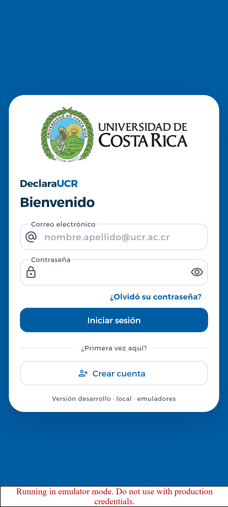 | 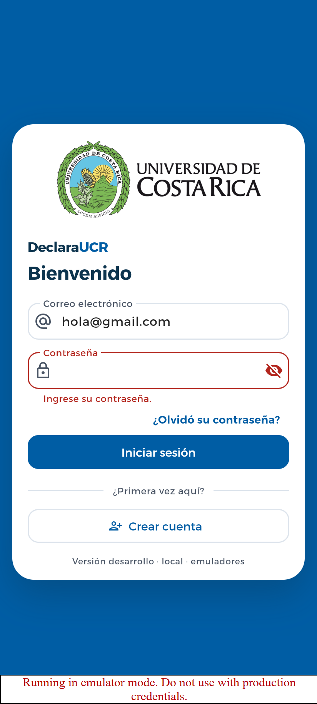 |  |

| R-04-inicio-declarante | R-05-lista-declaraciones | R-06-nueva-declaracion |
|---|---|---|
| 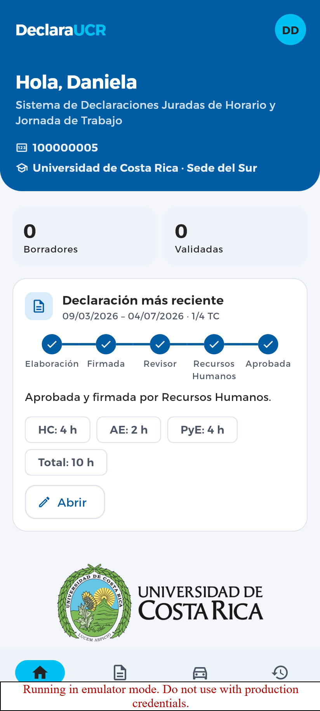 |  |  |

| R-07-borrador-sin-puesto | R-08-lista-de-puestos | R-09-horario-y-tareas |
|---|---|---|
| 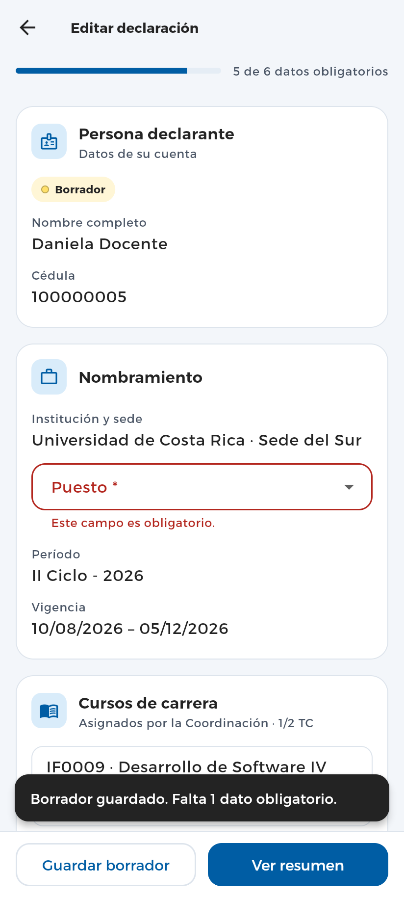 |  | 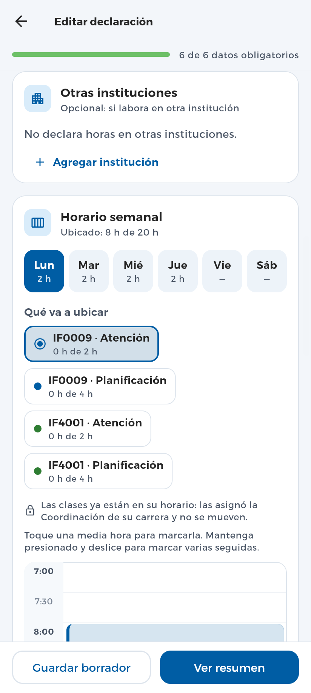 |

| R-10-borrador-tras-recargar | R-11-zonaje | R-12-historial |
|---|---|---|
|  |  |  |

| R-13-perfil | R-14-revisor-sin-acceso |
|---|---|
| 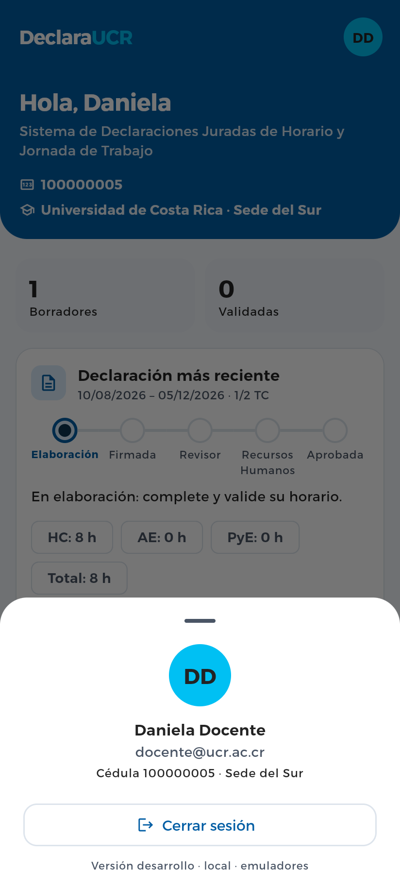 | 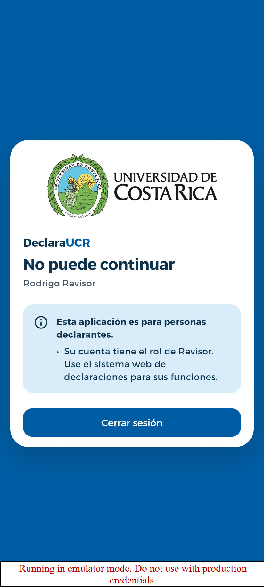 |

### Defecto D-01 antes y después (§4 y §5)

| D-01-antes-1-puesto-elegido | D-01-antes-2-sale-sin-aviso | D-01-antes-3-puesto-perdido | D-01-despues-dialogo |
|---|---|---|---|
| 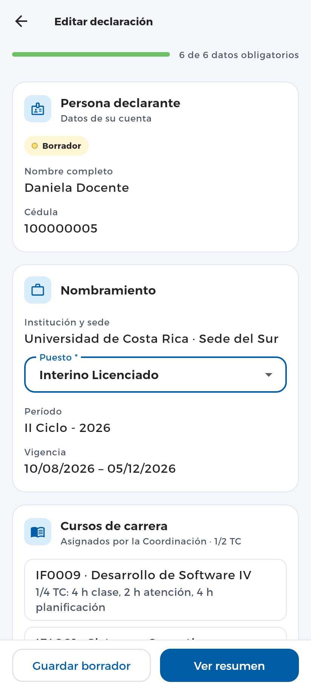 | 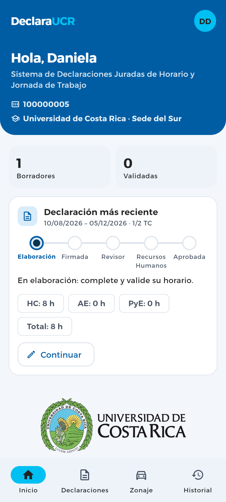 |  | 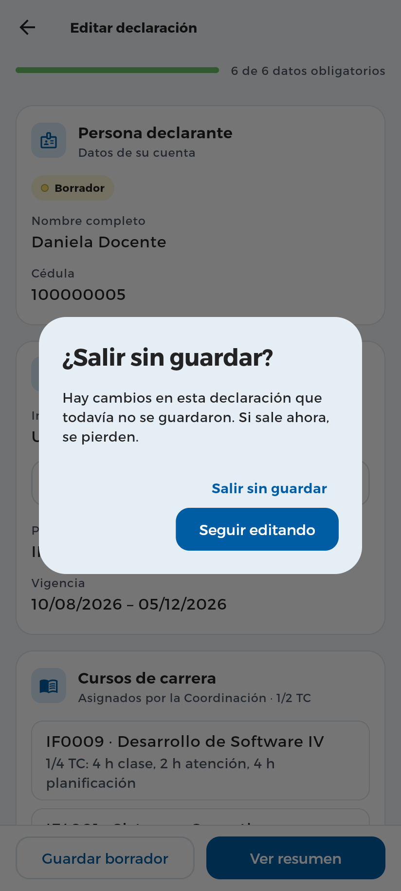 |

### Sesiones con usuarios (§6)

| P1-T0-inicio | P1-T1-borrador | P1-T2-resumen | P1-T3-estado |
|---|---|---|---|
|  |  |  | 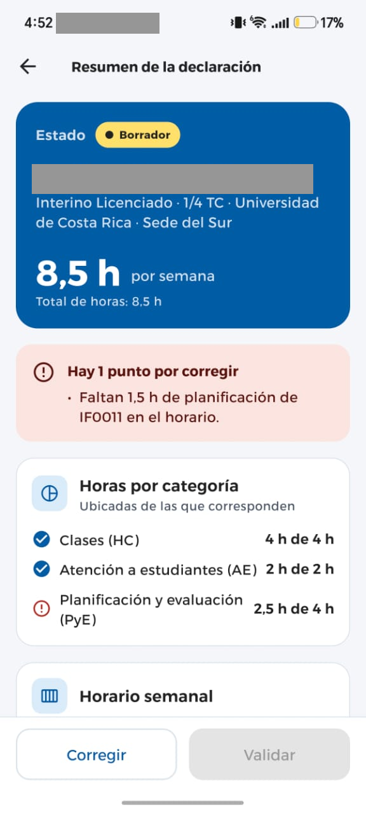 |
