# Informe de pruebas — DeclaraUCR

**Proyecto 2 · IF0009 Desarrollo de Software IV · UCR Sede del Sur**
Aplicación móvil del Sistema de Declaraciones Juradas de Horario y Jornada de Trabajo.

Este informe junta las tres capas de prueba que pide el descriptor (§7 y §8): los casos técnicos ejecutados en
el teléfono, las pruebas automatizadas sobre las reglas de mayor riesgo y las sesiones con personas usuarias.
Cada hallazgo termina en una corrección y una nueva comprobación, o en una justificación de por qué no se
corrigió.

> **Marcas para completar.** Lo que dice `[COMPLETAR]` depende de algo que solo el equipo puede hacer (una
> sesión con una persona, una prueba en otro teléfono). Todo lo demás ya está ejecutado y tiene evidencia.

---

## 1. Versiones evaluadas

| Versión | Commit | Dónde se usó |
|---|---|---|
| 2.0.0+5 | `fc21a84` | Casos técnicos CP-01 a CP-07 (19/11/2026) |
| 2.0.0+6 | `fc4caba` | CP-06 (persistencia tras reinstalar y actualizar) |
| 2.0.0+7 | `afeb1ee` (fusionado en `af4b3f2`, PR #8) | Recorrido exploratorio y correcciones del 20/11/2026; versión para las sesiones con usuarios |
| 2.0.0+8 | `abc5818` (PR #34) | Correcciones de las sesiones (U-01, U-03 a U-07), rol «Superior» (P1-03); nueva comprobación con participantes (§6.7) |
| 2.0.0+9 | ver la [release](https://github.com/CrisSalas07/DeclaraUCR/releases/tag/v2.0.0%2B9) (PR #35 y #36) | Recorrido guiado sobre las pantallas reales (U-06 rehecho) y la lista que ya no se salta un borrador recién guardado (T-09); recorrido completo en el emulador el 27/11/2026 (§3); nueva comprobación con participantes (§6.7) |
| 2.0.0+10 | `60d5813` ([release](https://github.com/CrisSalas07/DeclaraUCR/releases/tag/v2.0.0%2B10), PR #37) | Horario de las clases sobre los días y juramento del formulario oficial; los cambios se probaron en un Samsung Galaxy A34 (build de depuración) contra el backend real, y el flujo completo en el emulador (§3) |

Las sesiones con usuarios deben hacerse **todas con la misma versión** (§8). La recomendada es la 2.0.0+7,
porque ya trae la corrección de D-01, que afecta justo la tarea 1 del guion.

## 2. Casos técnicos (§7)

El detalle completo de cada caso (precondiciones, pasos, esperado, obtenido, versión y evidencia) está en
[`entregables/05-informe-pruebas/pruebas-tecnicas.md`](pruebas-tecnicas.md) y las capturas en `entregables/05-informe-pruebas/capturas/`. Este es el resumen:

| Caso | Qué cubre del §7 | Resultado | Evidencia |
|---|---|---|---|
| CP-01 | Proceso 1: crear, editar y recuperar un borrador | Aprobado | `CP-01-1.png`, `CP-01-2.png` |
| CP-02 | Proceso 2: horario, cálculo de horas y traslapes | Aprobado | `CP-02-1.png`, `CP-02-2.png` |
| CP-03 | Proceso 3: resumen, validación y estado (hasta la firma) | Aprobado | `CP-03-1.png` a `CP-03-3.png` |
| CP-04 | Datos incompletos o inválidos | Aprobado | `CP-04-1.png`, `CP-04-2.png` |
| CP-05 | Restricciones de acceso por rol | Aprobado | `CP-05-1.png`, `CP-05-2.png` |
| CP-06 | Persistencia y recuperación | Aprobado | `CP-06-1.png`, `CP-06-2.png` |
| CP-07 | Pérdida de conectividad | Aprobado | `CP-07-1.png` a `CP-07-3.png` |
| CP-08 | Instalación desde cero en otro teléfono | **Pendiente** `[COMPLETAR]` | `CP-08-1.png` + modelo y versión de Android |

**CP-08 es lo único que falta para cerrar §7.** Se hace con un teléfono que no sea el de desarrollo (puede ser
el de una de las personas de las sesiones, antes de empezar). Los pasos ya están escritos en `entregables/05-informe-pruebas/pruebas-tecnicas.md`.

## 3. Pruebas automatizadas

Ejecutadas el 20/11/2026 sobre el código de la 2.0.0+7, con `flutter analyze` y `flutter test`:

| Comprobación | Resultado |
|---|---|
| `flutter analyze` | Sin problemas |
| `flutter test` | **109 pruebas, todas pasan** (eran 107; se agregaron 2 por los defectos D-01 y D-02) |

Qué reglas de negocio de alto riesgo cubren:

| Regla | Archivo | Pruebas |
|---|---|---|
| Traslapes en el día, entre instituciones y por vigencia | `test/domain/overlap_detector_test.dart`, `declaration_validator_test.dart` | 7 + parte de 13 |
| Horas por curso según la jornada (clase, atención, planificación) | `test/domain/rules_test.dart`, `declaration_validator_test.dart` | 4 + parte de 13 |
| Cuadrícula: almuerzo cerrado, máximo 10 h por día, clases fijas | `test/domain/schedule_grid_test.dart` | 12 |
| Transiciones de estado y escritura en el esquema del Proyecto 1 | `test/data/proyecto1_write_test.dart`, `declaration_signer_test.dart` | 11 + 4 |
| Huella SHA-256 de la firma igual a la de la web | `test/domain/content_hash_test.dart` | 3 |
| Sin conexión no se guarda ni se pierde nada | `test/connectivity_test.dart`, `persistence_test.dart` | 5 + 7 |
| Pantalla de 360 × 690 dp sin desbordes | `test/widget_test.dart` | 1 (corre en todas las pruebas de pantalla) |
| Salir con cambios sin guardar pregunta antes (D-01) | `test/widget_test.dart` | 1 (nueva) |
| Cada media hora se puede ubicar con TalkBack (D-02) | `test/widget_test.dart` | 1 (nueva) |

Además, contra las **reglas reales del Proyecto 1** en los emuladores: `backend/proyecto1/verify.mjs` (nadie lee
ni escribe lo de otra persona, no hay dos declaraciones por período, no se salta la firma) e
`integration_test/sign_rules_test.dart` (la firma desde el código de la app).

**Repetidas el 27/11/2026 sobre la 2.0.0+9:** `flutter analyze` sin problemas y **118 pruebas, todas pasan**
(se agregaron las de U-03 a U-07, el recorrido guiado y los datos de la docente de ejemplo). En el emulador
Android (Pixel 4, Android 11) con las reglas del P1: `verify.mjs` (26 comprobaciones), `sign_rules_test.dart` y
`release_8_rules_test.dart` (lista, edición del perfil y guardar sin conexión) pasan. Además se hizo **a mano el
recorrido completo** con la cuenta ficticia `docente@ucr.ac.cr`: recorrido guiado, crear la declaración, ubicar
atención y planificación en la cuadrícula, validar, firmar y enviar al superior (queda «Pendiente de firma del
superior»), ver el PDF, Zonaje, Historial y editar el teléfono en «Mis datos»; todo funcionó. Las capturas de
esa corrida están en la guía de uso (`07-guia-uso/capturas/`).

**Repetidas el 27/11/2026 sobre la 2.0.0+10:** `flutter analyze` sin problemas y **121 pruebas, todas pasan**
(nuevas: la tarjeta con las clases de cada curso, mantener presionado y deslizar, y el juramento del formulario
oficial). El PDF generado se revisó en la vista previa y firmado: el juramento cabe en dos líneas sin tapar las
firmas. En el emulador Android (Medium Phone) con los datos ficticios se hizo de nuevo el flujo completo con
`docente@ucr.ac.cr`: ubicar las 20 h con «mantener presionado y deslizar», validar, firmar y ver el PDF; las
capturas `04-horario`, `09-firma` y `10-pdf` de la guía son de esa corrida.

## 4. Recorrido exploratorio (20/11/2026)

Antes de las sesiones con usuarios se recorrió la app como lo haría una docente, para encontrar lo que los
casos escritos no buscan.

- **Cómo:** build web de la app en un navegador con pantalla de teléfono (412 × 915), contra los emuladores
  de Firebase con las reglas del Proyecto 1 y los datos ficticios de `backend/proyecto1/seed.mjs`. Cuentas
  `docente`, `docente2` y `superior`.
- **Límite:** no es el APK en un teléfono. Sirve para encontrar defectos de lógica y de accesibilidad, no
  sustituye CP-08.
- **Evidencia:** `entregables/05-informe-pruebas/capturas/`.

| # | Qué se hizo | Qué pasó | Captura |
|---|---|---|---|
| R-01 | Abrir la app | Inicio de sesión con la firma UCR y la versión al pie | `R-01-inicio-sesion.png` |
| R-02 | Entrar sin contraseña | "Ingrese su contraseña." en el campo, sin llamar al servidor | `R-02-contrasena-vacia.png` |
| R-03 | Entrar con una cuenta que no existe | "Correo o contraseña incorrectos." No dice cuál de los dos falló (bien: no revela qué correos existen) | `R-03-credenciales-incorrectas.png` |
| R-04 | Entrar como docente | Inicio con el seguimiento de la declaración más reciente (I Ciclo, aprobada) | `R-04-inicio-declarante.png` |
| R-05 a R-08 | Nueva declaración y guardar sin puesto | Se guarda como borrador, marca "Este campo es obligatorio." y avisa "Falta 1 dato obligatorio." | `R-05` a `R-08` |
| R-09 | Horario semanal | Clases de la Coordinación fijas con candado; solo se ofrecen atención y planificación | `R-09-horario-y-tareas.png` |
| R-10 | Recargar la app | El borrador sigue ahí, con 8 h de clases | `R-10-borrador-tras-recargar.png` |
| R-11 a R-13 | Zonaje, historial y perfil | Zonaje de solo lectura con la observación de RRHH; historial por año | `R-11` a `R-13` |
| R-14 | Entrar como superior | "No puede continuar": la app es solo para declarantes | `R-14-superior-sin-acceso.png` |

### Defectos encontrados en el recorrido

| Id | Defecto | Impacto | Prioridad |
|---|---|---|---|
| **D-01** | Si la persona cambia algo (por ejemplo, el puesto) y toca **Atrás** sin guardar, la app sale sin avisar y el cambio se pierde | Pérdida silenciosa de información, justo lo que §5 prohíbe. Le puede pasar a cualquiera que crea que la app guarda sola | **Alta** |
| **D-02** | Las medias horas libres de la cuadrícula no existen para TalkBack: una persona que usa lector de pantalla no puede ubicar horas | Una persona ciega o con baja visión no completa el proceso 2 | **Alta** (accesibilidad, §5) |
| **D-03** | En Inicio, los chips "HC: 4 h", "AE: 2 h", "PyE", "Total" se anuncian como casillas sin marcar | Confunde con lector de pantalla; parece algo que hay que marcar | Baja |

Evidencia de D-01 antes de corregir: `D-01-antes-1-puesto-elegido.png` (puesto elegido),
`D-01-antes-2-sale-sin-aviso.png` (al tocar Atrás vuelve a Inicio sin preguntar),
`D-01-antes-3-puesto-perdido.png` (al reabrir, el puesto está vacío).

Observaciones que **no** son defectos de la app (se anotan para no confundirlas):

- En el build web contra emuladores, al **recargar la página con una sesión abierta**, el SDK web de Firebase
  no siempre se conecta al emulador de Auth y el siguiente inicio de sesión falla con un error genérico. Pasa
  solo en web + emuladores; el APK usa el backend real y no recarga páginas. No se corrige.

## 5. Defectos corregidos y nueva comprobación

| Id | Corrección | Nueva comprobación | Estado |
|---|---|---|---|
| D-01 | `DeclarationFormState.unsaved` marca los cambios sin guardar; el formulario pregunta "¿Salir sin guardar?" con **Seguir editando** (botón principal) y **Salir sin guardar**. Al guardar, deja de preguntar. Archivos: `lib/state/declaration_form_state.dart`, `lib/screens/declaration_form_screen.dart` | Prueba automatizada "leaving with unsaved changes asks first (D-01)". En la app: elegir puesto → Atrás → aparece el diálogo (`D-01-despues-dialogo.png`). `[COMPLETAR: repetir en el teléfono con el APK 2.0.0+7]` | Verificada (automatizada y en build web) |
| D-02 | Cada media hora de la cuadrícula es un botón para TalkBack: dice "Lunes, 10:00 a 10:30: libre" (o la tarea que tiene) y al tocarla dos veces la marca con la tarea elegida. El almuerzo dice "almuerzo, cerrado". Archivo: `lib/widgets/schedule_editor.dart` | Prueba automatizada "with TalkBack, each half hour says what it has and places (D-02)": ubica 30 min por la acción de accesibilidad y el lunes pasa de 2 h a 2,5 h. `[COMPLETAR: probar en el teléfono con TalkBack activado]` | Verificada (automatizada) |
| D-03 | Los chips de horas se leen como texto (`_HoursChip` en `lib/screens/home_screen.dart`) | Revisión del árbol de accesibilidad | Corregida |

Defectos anteriores (encontrados en el teléfono antes de la 2.0.0+5), ya corregidos y comprobados: período
cerrado que seguía apareciendo, sección de cursos duplicada, PDF sin zoom, palabras cortadas con letra grande.
Detalle en `entregables/05-informe-pruebas/pruebas-tecnicas.md`.

## 6. Pruebas con usuarios (§8)

### 6.1 Preparación

La bitácora de las tres sesiones (guion, consentimiento, perfil, tareas, ayudas y capturas) es
`sesiones-usuarios/bitacora-sesiones.docx`. Las capturas de cada tarea están en `capturas/` (`P1-T0-inicio.png` …).

- **Versión:** 2.0.0+7, la misma para todas las sesiones.
- **Cuentas:** cada participante crea la suya en la sesión (T0) con su correo `@ucr.ac.cr` y su propia
  contraseña; el equipo no las conoce. Cédula y teléfono **ficticios**, de una tarjeta que da el equipo.
  Después del registro, el equipo asigna en la web el superior y los mismos cursos de prueba a todas.
  Al terminar el estudio, las cuentas se desactivan. Nunca la cuenta personal de la persona participante.
- **Registro:** las sesiones no se graban (el descriptor no lo exige). Quien anota llena la bitácora durante
  la sesión: tiempos con la hora del reloj, lo que la persona hace y dice (frases textuales entre comillas) y
  cada ayuda. Se suman las capturas al final de cada tarea y las respuestas del formulario.
- **Consentimiento:** participación voluntaria, preguntada al inicio y marcada en la bitácora.
- **Quién observa:** una persona del equipo guía y anota; no ayuda salvo que la persona se trabe más de un
  minuto o lo pida. Cada ayuda se anota.

### 6.2 Guion (registro y tres tareas representativas)

Antes de empezar se lee esto, tal cual:

> "Gracias por ayudarnos. Vamos a probar la app, no a usted: si algo no sale, es un problema de la app. Le voy a
> pedir tres cosas. Piense en voz alta: diga lo que busca y lo que espera que pase. Yo solo voy a mirar y tomar
> notas."

| Tarea | Lo que se le dice a la persona | Propósito | Se considera completada cuando… |
|---|---|---|---|
| T0 | "Usted es docente y es la primera vez que usa DeclaraUCR. Cree su cuenta con su correo de la UCR y una contraseña suya, use el nombre, la cédula y el teléfono de esta tarjeta, y complete su perfil con la sede y la carrera que le indicamos." | Registro e inicio de sesión | La persona entra a la app y ve Inicio con su nombre, sin ayuda para escribir datos |
| T1 | "Es inicio de ciclo. Empiece su declaración jurada de este período, elija su puesto y déjela guardada para terminarla después." | Proceso 1: crear y guardar un borrador | La declaración aparece como **Borrador** en la lista con el puesto elegido |
| T2 | "Ya tiene las clases que le asignó la Coordinación. Ubique las 2 horas de atención a estudiantes de IF0009 el lunes, después de su clase." (IF0009 con clase el lunes y el miércoles de 8:00 a 10:00, igual en las tres cuentas: 4 h de clase dan 2 h de atención) | Proceso 2: registrar horario | Las 2 h de atención de IF0009 quedan ubicadas: ya no aparecen entre las horas faltantes del resumen |
| T3 | "Revise si a su declaración le falta algo para poder validarla y diga en qué estado está." | Proceso 3: resumen, validaciones y estado | La persona dice el estado (**Borrador**) y menciona al menos una hora faltante que muestra el resumen |

### 6.3 Perfil de participantes

Sin nombres ni cédulas: solo la relación con el proceso. Al menos una persona debe ser del perfil previsto
(docente, o alguien que haya llenado una declaración jurada de jornada).

| Id | Relación con el contexto de uso | ¿Perfil previsto? | Teléfono que usó | Fecha | Bitácora |
|---|---|---|---|---|---|
| P1 | Estudiante; nunca ha llenado una declaración jurada de jornada; usa el teléfono casi nunca para trámites | No | Honor 200 Lite, de la persona | 24/11/2026 | `bitacora-sesiones.docx` §3 |
| P2 | Amigo del equipo; nunca ha llenado una declaración jurada de jornada; usa el teléfono a veces para trámites | No | Honor Magic7 Lite, de la persona | 24/11/2026 | `bitacora-sesiones.docx` §4 |
| P3 | Docente de la Sede del Sur, carrera Informática Empresarial; llenó la declaración jurada durante varios años, a mano en Excel, sin sistema; usa el teléfono para trámites con frecuencia | **Sí** | `[COMPLETAR: modelo]` | 27/11/2026 | `bitacora-sesiones.docx` §5 |

### 6.4 Resultados por tarea

Tiempo aproximado en minutos. Éxito: **Sí**, **Con ayuda** o **No**.

| Participante | Tarea | Éxito | Tiempo | Errores observados | Ayudas dadas | Evidencia |
|---|---|---|---|---|---|---|
| P1 | T0 | Con ayuda | ≈ 9 (≈ 4:15–4:24 p. m.) | — | Sí; el detalle no se anotó | `P1-T0-inicio.png` |
| P2 | T0 | Sí | 3 (9:05–9:08 p. m.) | — | Ninguna | `P2-T0-inicio.png` |
| P3 | T0 | Sí | ≈ 5 (3:40–3:45 p. m.) | — | Ninguna | `P3-T0-inicio.png` |
| P1 | T1 | Con ayuda | ≈ 20 (≈ 4:30–4:50 p. m.) | Al inicio no sabía cómo empezar la declaración (nunca había hecho una) | Sí; el detalle no se anotó | `P1-T1-borrador.png` |
| P1 | T2 | Con ayuda | 2 (4:50–4:52 p. m.) | Intentó ubicar más atención de la que le tocaba; la app lo detuvo («Ya ubicó todas las horas de atención…») | Sí; el detalle no se anotó | `P1-T2-resumen.png` |
| P1 | T3 | Con ayuda | ≈ 3 (4:52–≈ 4:55 p. m.) | Llegó al resumen: **Borrador**, «Faltan 1,5 h de planificación de IF0011», Validar deshabilitado. En T2 la planificación estaba completa (4 h de 4 h); entre las dos capturas se quitaron 1,5 h. Lo de T2 y T3 no se guardó (Firebase: único guardado a las 4:50:17 p. m.) | Sí; el detalle no se anotó | `P1-T3-estado.png` |
| P2 | T1 | Con ayuda | 8 (9:19–9:27 p. m.) | Se adelantó hasta Validar; no sabía cómo tocar los cuadros para asignar horas; después de Validar no vio «Firmar y enviar» y con Atrás volvió al editor | Contexto de los proyectos que puede declarar; cómo tocar la cuadrícula | `P2-T1-borrador.png` |
| P2 | T2 | Sí | ≈ 10 (no anotado) | No eligió la tarea antes de tocar; no descubrió «mantenga presionado y deslice» | Ninguna (la de la cuadrícula fue en T1) | `P2-T2-resumen.png` |
| P2 | T3 | Sí | ≈ 5 (no anotado) | — Dijo «validada y guardada»; después firmó y envió (9:29) | Ninguna | `P2-T3-estado.png` |
| P3 | T1 | Sí | ≈ 6 (3:45–3:51 p. m.) | — | Ninguna | `P3-T1-borrador.png` |
| P3 | T2 | Sí | ≈ 5 (3:51–3:56 p. m.) | — | Ninguna | `P3-T2-resumen.png` |
| P3 | T3 | Sí | ≈ 4 (3:56–4:00 p. m.) | — | Ninguna | `P3-T3-estado.png` |

**Diferencias de P1 con el guion.** La cuenta recibió el curso **IF0011** (1/4 TC) en lugar de IF0009; las
2 h de atención de T2 son las mismas. La persona usó su nombre y su cédula reales en lugar de los de la
tarjeta: en las capturas están tapados con barras grises. Las horas salen de la barra de estado de las capturas y, el fin de
T1, de la creación de la declaración en Firebase (4:50:17 p. m.); las marcadas con ≈ son estimadas porque no se
anotaron. La hora de inicio anotada (4:40 aprox.) no cuadraba con la captura de T0 (4:24): la sesión empezó ≈ 4:15.

**Diferencias de P2 con el guion.** El curso se asignó como IF0009 1/2 TC (4 h de atención, no 2 h) y la persona
agregó un proyecto de 0,5 h. No usó los datos de la tarjeta, sino otros inventados. En T1 se adelantó hasta
Validar, y al final **firmó y envió** la declaración (queda «Pendiente de firma del superior»). Las capturas van de
9:11 a 9:30 p. m.; los tiempos aproximados de T2 y T3 no cuadran con ellas.

**Diferencias de P3 con el guion.** La sesión fue el 27/11/2026 de 3:40 a 4:00 p. m. y se usó la **2.0.0+9**
(con el recorrido guiado), no la 2.0.0+7: P1 y P2 ya habían mostrado que sin guía no se entendía la app (U-06).
Solo se anotaron el inicio y el fin; los 20 minutos se repartieron entre las tareas según lo observado, por
eso los tiempos llevan ≈. La persona usó su nombre y cédula reales. La Coordinación le asignó clases el miércoles
de 8:00 a 11:00 y el jueves de 13:00 a 17:00. **No pidió ayuda ni preguntó cómo hacer nada**: según quien guió,
gracias al recorrido guiado del inicio.

### 6.5 Percepción

Al terminar, cada persona llena el formulario de retroalimentación marcando su número (P1, P2 o P3): facilidad
de uso de 1 a 5 y comentarios abiertos (§8), además de utilidad, claridad y funcionamiento. Evidencia:
`capturas/respuestas-formulario.pdf`.

| Participante | Facilidad (1–5) | Comentario (con sus palabras) |
|---|---|---|
| P1 | 5 (utilidad 5, claridad 5, funcionamiento 5) | «La verdad no me pareció difícil, lo entendí muy bien […] no tuve alguna dificultad.» Cambiaría: que el **Puesto** no deje elegir uno que no es el suyo (eligió Catedrático siendo Interino Licenciado). «Felicitarles, me gustó la app, muy entendible!» |
| P2 | 4 (utilidad 5, claridad 3, funcionamiento 4) | En el formulario: «Es un poco confuso el inicio ya que no sabía qué hacía cada botón.» Cambiaría: «Poner un tutorial guía al instalar la aplicación». Errores: ninguno. En la sesión dijo lo mismo: le faltó un tutorial introductivo para saber qué hace cada cosa |
| P3 | `[COMPLETAR: si llenó el formulario]` | Pidió que el juramento fuera el del **formulario oficial** de la Universidad (`[COMPLETAR: sus palabras]`) |
| **Promedio** | | |

### 6.6 Hallazgos de las sesiones

| Id | Problema observado | Quién y en qué tarea | Impacto | Prioridad | Acción |
|---|---|---|---|---|---|
| U-01 | No sabía cómo empezar la declaración | P1, T1 | Necesitó ayuda para empezar | Baja | Cubierta por el recorrido de primer uso de U-06 (paso «Inicio»). 2.0.0+8 |
| U-02 | La lista de **Puesto** deja elegir cualquier puesto, aunque no sea el de la persona (lo dijo P1 en el formulario) | P1, T1 | Una declaración con un puesto equivocado llega al superior; hoy solo el superior lo detecta | Media | Pendiente con justificación: la app no tiene de dónde sacar el puesto real de la persona. Propuesta: que Administración lo asigne en la web y la app lo muestre fijo (matriz U-02) |
| U-03 | No sabía cómo tocar los cuadros para asignar horas en la cuadrícula; no entendió la lógica de la app | P2, T1–T2 | Necesitó ayuda para ubicar horas (proceso 2) | Alta | Encima de la cuadrícula se ve siempre qué se ubica con cada toque, con su color y pasos numerados. 2.0.0+8; se vuelve a probar con P2 (§6.7) |
| U-04 | Después de Validar no vio el botón «Firmar y enviar a mi superior» | P2, T1 | No supo cuál era el siguiente paso | Media | Después de Validar, el botón principal es **Firmar y enviar** y un aviso dice que es el siguiente paso. 2.0.0+8 |
| U-05 | Después de Validar, Atrás lo devolvió al editor y la declaración volvió a Borrador | P2, T1 | Salió del resumen sin firmar y tuvo que validar otra vez | Media | Atrás después de validar vuelve al inicio sin tocar la declaración; solo «Corregir» abre el editor. 2.0.0+8 |
| U-06 | Pide un tutorial la primera vez que explique cada parte (lo dijeron P2 y, en parte, P1) | P2 (y P1, T1) | Sin guía no entiende la lógica de la app | Media | Recorrido la primera vez en el teléfono, y en el perfil («Cómo funciona»): 4 páginas en la 2.0.0+8; en la 2.0.0+9, un recorrido guiado sobre las pantallas reales con una docente ficticia que enfoca cada parte y explica qué va en cada campo |
| U-08 | El juramento no era el del formulario oficial de la Universidad | P3 (después de las tareas) | El texto que firma la persona no coincide con el que conoce del formato oficial | Media | El juramento predeterminado es el del formulario oficial, palabra por palabra; la plantilla de Administración en la web sigue mandando. 2.0.0+10 |
| U-07 | El perfil solo muestra los datos: no deja corregir el nombre ni la cédula | P2 (después de las tareas) | Si se equivoca al registrarse (P1 puso sus datos reales), no lo puede corregir | Media | Editar nombre, cédula (se reserva la nueva y se libera la anterior) y teléfono desde el perfil; un borrador sin firmar toma los datos corregidos. Correo, sede y carrera siguen con Administración. 2.0.0+8 |

Qué vigilar en particular (son los puntos donde el recorrido sugiere que alguien se puede trabar):

- **T2:** que la persona entienda que primero elige la tarea ("Qué va a ubicar") y después toca la media hora;
  y que descubra "mantenga presionado y deslice".
- **T3:** que encuentre **Ver resumen** y lea "Hay N puntos por corregir".
- **T1:** que no salga con Atrás antes de guardar (con la 2.0.0+7 ya le pregunta).

### 6.7 Mejoras y nueva comprobación con participantes

El descriptor pide volver a probar los problemas de mayor impacto con al menos una de las personas.

Cambios aplicados en la 2.0.0+8 (commit `abc5818`, PR #34). Antes de entregarla al participante se
comprobaron con pruebas automatizadas (117 pasan, 27/11/2026) y en el emulador Android contra las reglas del
P1 (`integration_test/release_8_rules_test.dart`).

| Hallazgo | Cambio aplicado (commit) | Quién lo volvió a probar | Resultado | Evidencia |
|---|---|---|---|---|
| U-03 | Qué se ubica con cada toque, siempre a la vista (`abc5818`) | `[COMPLETAR: P2]` | `[COMPLETAR]` | `R-P2-T2-….png` |
| U-04 / U-05 | Firmar como siguiente paso; Atrás vuelve al inicio (`abc5818`) | `[COMPLETAR: P2]` | `[COMPLETAR]` | `R-P2-T1-….png` |
| U-06 | Recorrido de primer uso (`abc5818`) | `[COMPLETAR: P2]` | `[COMPLETAR]` | `R-P2-T0-….png` |
| U-07 | Editar mis datos (`abc5818`) | `[COMPLETAR: P2]` | `[COMPLETAR]` | `R-P2-perfil-….png` |
| U-01, U-03, U-06 | Recorrido guiado sobre las pantallas reales (2.0.0+9, PR #36) | P3 (persona nueva, docente), 27/11/2026 | Hizo T0 a T3 sin ayuda ni preguntas; según quien guió, gracias al recorrido | Bitácora §5, `P3-T0-…` a `P3-T3-….png` |
| T-08 | Lista actualizada al guardar un borrador (no se reprodujo en emulador) | `[COMPLETAR: equipo, en el teléfono]` | `[COMPLETAR]` | `R-T08-….png` |

## 7. Conclusión

`[COMPLETAR al terminar las sesiones: 3 o 4 líneas. Qué tan bien completaron las tareas, qué fue lo más
difícil, qué se corrigió y qué quedó pendiente con su justificación.]`

## Anexo: capturas

Las de los casos técnicos están en `pruebas-tecnicas.pdf`.

### Recorrido exploratorio (§4)

| R-01-inicio-sesion | R-02-contrasena-vacia | R-03-credenciales-incorrectas |
|---|---|---|
|  |  | 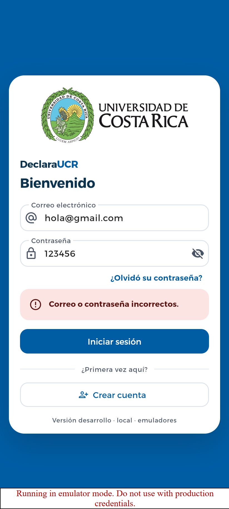 |

| R-04-inicio-declarante | R-05-lista-declaraciones | R-06-nueva-declaracion |
|---|---|---|
|  | 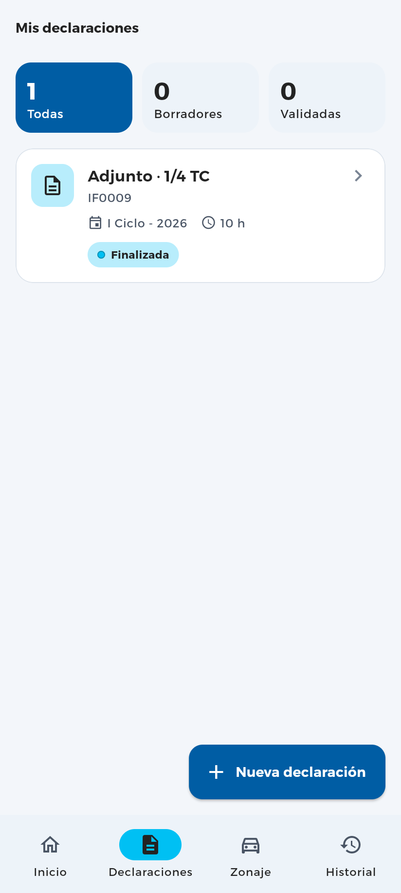 | 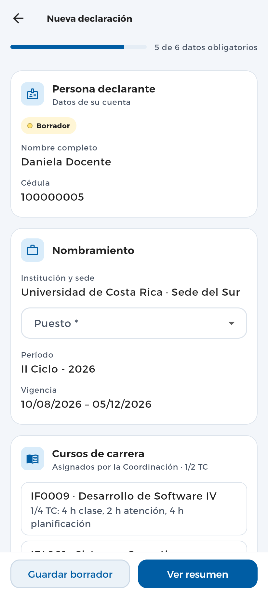 |

| R-07-borrador-sin-puesto | R-08-lista-de-puestos | R-09-horario-y-tareas |
|---|---|---|
|  | 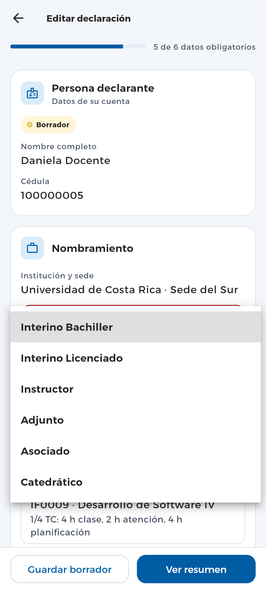 |  |

| R-10-borrador-tras-recargar | R-11-zonaje | R-12-historial |
|---|---|---|
|  | 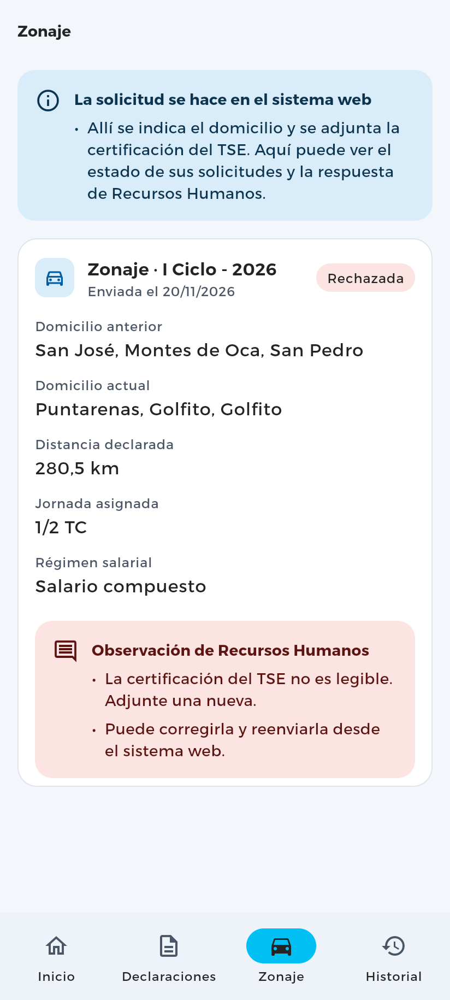 | 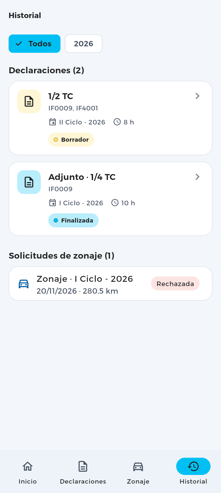 |

| R-13-perfil | R-14-superior-sin-acceso |
|---|---|
|  |  |

### Defecto D-01 antes y después (§4 y §5)

| D-01-antes-1-puesto-elegido | D-01-antes-2-sale-sin-aviso | D-01-antes-3-puesto-perdido | D-01-despues-dialogo |
|---|---|---|---|
|  |  |  |  |

### Sesiones con usuarios (§6)

| P1-T0-inicio | P1-T1-borrador | P1-T2-resumen | P1-T3-estado |
|---|---|---|---|
| 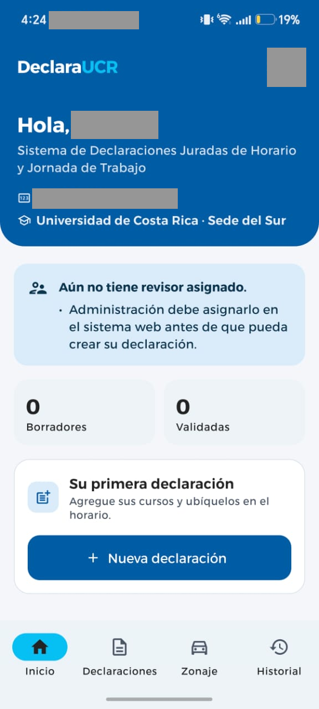 | 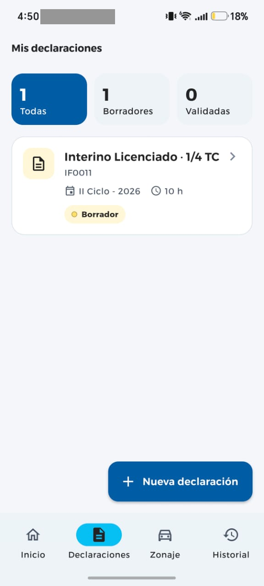 | 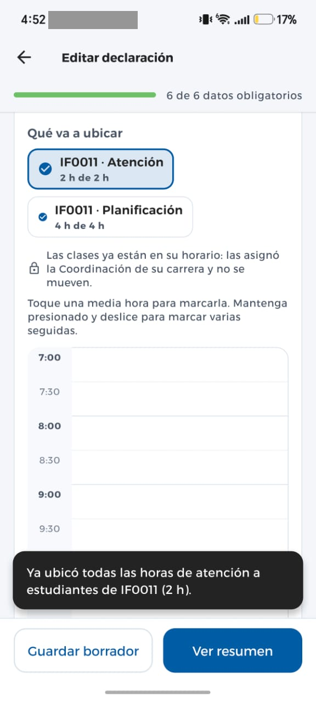 |  |

| P2-T0-inicio | P2-T1-borrador | P2-T2-resumen | P2-T3-estado |
|---|---|---|---|
| 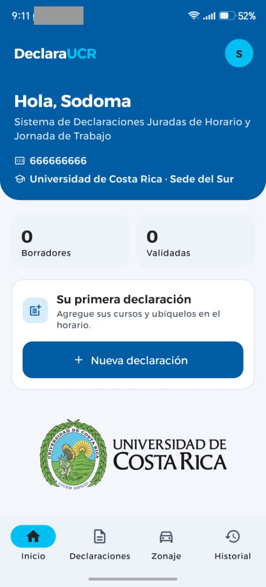 | 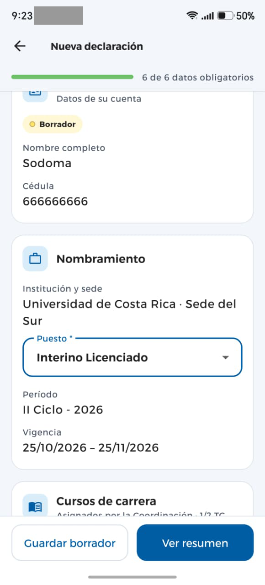 | 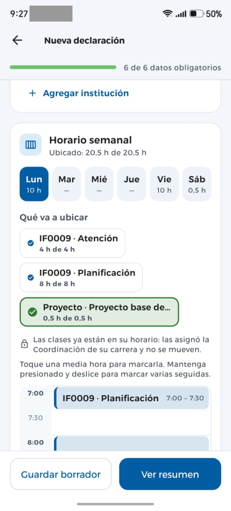 | 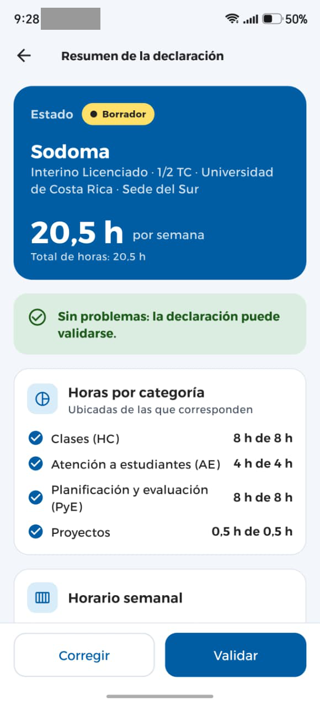 |
