# Guía de uso — DeclaraUCR

**Su declaración jurada de horario y jornada, desde el teléfono.**

Esta guía es para la persona docente que llena su declaración. No necesita saber nada técnico.

---

## 1. Antes de empezar

- Un teléfono Android 7.0 o más reciente, con internet.
- Su cuenta del sistema de declaraciones (la misma de la web). Si es una prueba, use la cuenta que le dio el
  equipo.
- La Coordinación de su carrera ya debe haberle asignado los cursos del ciclo. Si no, la app se lo dice y no
  deja crear la declaración.

## 2. Instalar la app

1. Abra en el teléfono el enlace de descarga que le dieron y descargue el archivo `DeclaraUCR-v….apk`.
2. Toque el archivo descargado (en las notificaciones o en **Archivos › Descargas**).
3. La primera vez Android le pide permiso para **instalar apps de fuentes desconocidas**. Actívelo para el
   navegador o la app de archivos y vuelva atrás.
4. Toque **Instalar**. Si aparece *Google Play Protect*, elija **Instalar de todas formas**: la app no está en
   Google Play y por eso Android no la conoce.
5. Abra **DeclaraUCR**.

**¿Ya la tenía instalada?** Instale la versión nueva encima y no pierde su sesión.

## 3. Crear su cuenta (solo la primera vez)

Si ya usa la web de declaraciones, su cuenta es la misma: pase a **Iniciar sesión**.

1. En el inicio de sesión toque **Crear cuenta**.
2. Llene **Nombre completo**, **Número de cédula**, **Teléfono** y **Correo electrónico** (su correo
   `@ucr.ac.cr`).
3. Escriba una **Contraseña** (mínimo 8 caracteres, con letras y números), repítala en **Confirmar
   contraseña** y toque **Crear cuenta**.
4. En **Complete su perfil**, elija su **Sede** y su **Carrera** y toque **Guardar**. Solo se eligen una vez;
   después solo Administración puede cambiarlas.

Si dice *"Ya existe una cuenta con ese correo."*, ya tiene cuenta: inicie sesión con ella. Para que pueda crear
su declaración, la Coordinación le asigna los cursos y Administración su superior.

## 4. Iniciar sesión

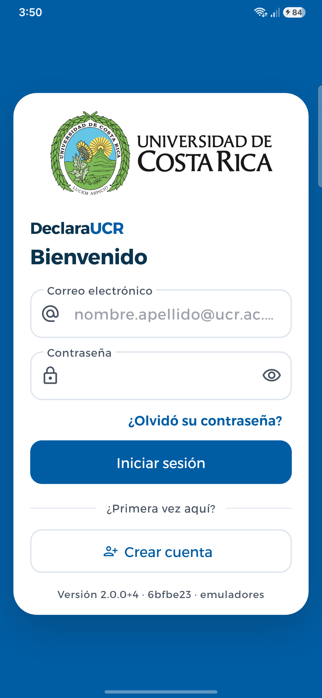

Escriba su correo y su contraseña y toque **Iniciar sesión**. Al pie aparece la versión de la app, útil si
tiene que reportar un problema.

- *"Correo o contraseña incorrectos."* Revise los dos. Si olvidó la contraseña, toque **¿Olvidó su
  contraseña?** y le llega un enlace al correo.
- *"No puede continuar"*: su cuenta no es de persona declarante (por ejemplo, es de superior). Esas funciones
  están en la web.

## 5. Inicio

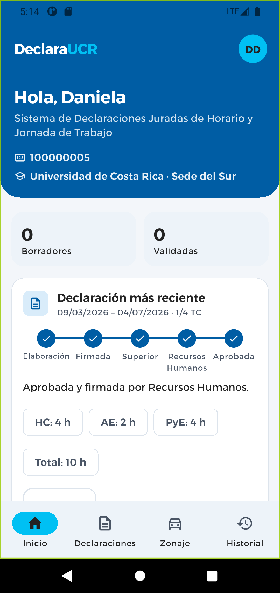

Inicio le muestra cuántos borradores y declaraciones validadas tiene, y en qué paso va la más reciente:
**Elaboración → Firmada → Superior → Recursos Humanos → Aprobada**. Debajo están sus horas por tipo (HC: clases,
AE: atención a estudiantes, PyE: planificación y evaluación) y el botón para **Continuar**.

Abajo están las cuatro secciones: **Inicio**, **Declaraciones**, **Zonaje** e **Historial**.

## 6. Crear su declaración (borrador)

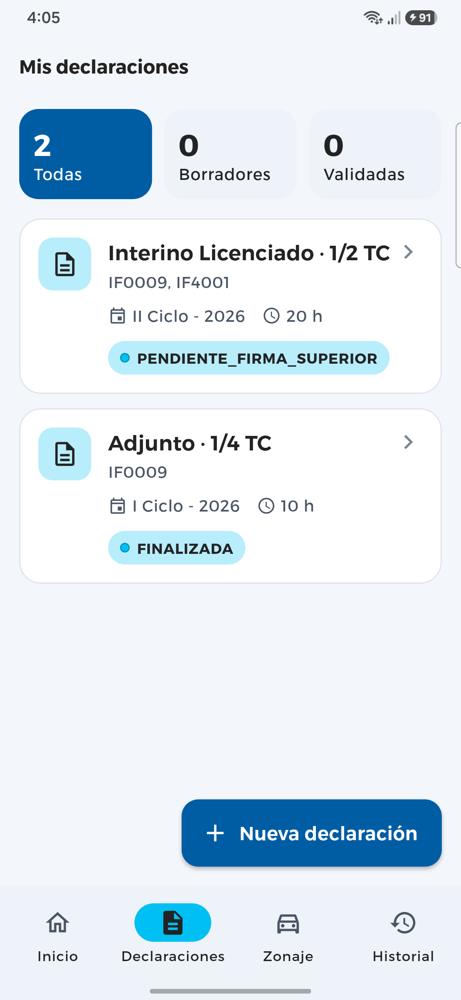

1. Vaya a **Declaraciones** y toque **Nueva declaración**.
2. Su nombre, su cédula, la sede, el período y la vigencia ya vienen llenos. Solo elija su **Puesto**.
3. En **Cursos de carrera** aparecen los cursos que le asignó la Coordinación, con sus horas.

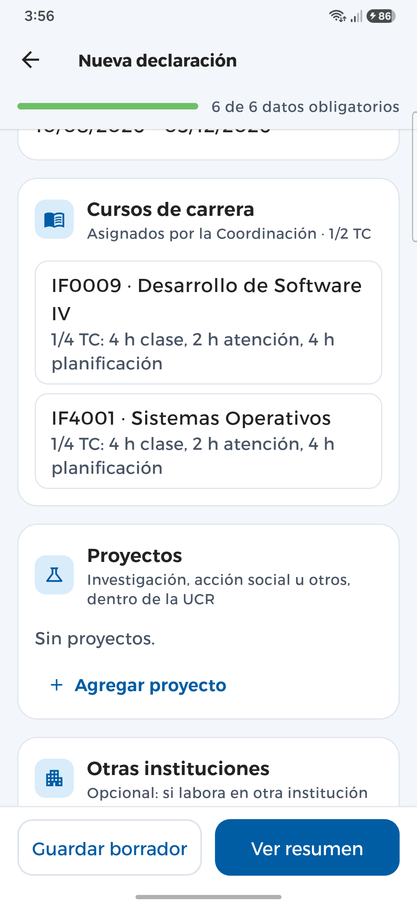

4. Si tiene proyectos o trabaja en otra institución, agréguelos con **Agregar proyecto** o **Agregar
   institución**.
5. Toque **Guardar borrador**. Puede guardar aunque falten datos: la app le dice cuántos faltan, por ejemplo
   *"Borrador guardado. Falta 1 dato obligatorio."*

**Para seguir otro día:** en Inicio toque **Continuar**, o abra la declaración desde **Declaraciones**.

> Si toca **Atrás** con cambios sin guardar, la app le pregunta *"¿Salir sin guardar?"*. Elija **Seguir
> editando** y guarde.

## 7. Ubicar su horario

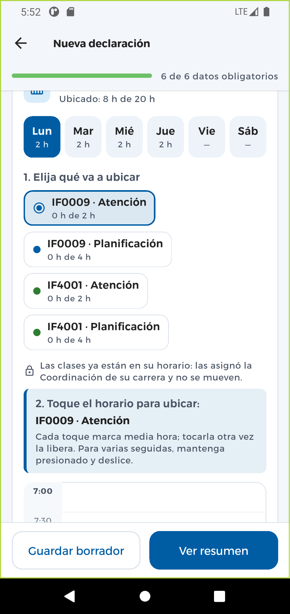

Las **clases ya están en su horario**, con un candado: las asignó la Coordinación y no se mueven. Usted ubica
la atención a estudiantes, la planificación, los proyectos y las otras instituciones.

1. Elija el día arriba (**Lun** a **Sáb**).
2. En **Qué va a ubicar**, toque la tarea, por ejemplo *IF0009 · Atención*. Debajo dice cuánto lleva: *0 h de
   2 h*.
3. Toque una media hora libre para marcarla. Tóquela otra vez para liberarla.
4. Para marcar varias seguidas: **mantenga presionado y deslice** hacia abajo.
5. Si un día se repite, use **Copiar a otros días**.

Reglas que la app cuida por usted:

- Una tarea no toma más horas de las que le corresponden.
- De 12:00 a 13:00 es almuerzo y está cerrado.
- Ningún día pasa de 10 horas.
- Como cada media hora tiene una sola tarea, no se pueden traslapar.

**Con TalkBack:** cada media hora dice el día, la hora y lo que tiene (*"Lunes, 10:00 a 10:30: libre"*). Toque
dos veces para marcarla con la tarea elegida.

## 8. Revisar y validar

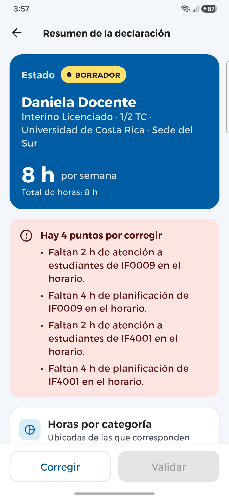

Toque **Ver resumen**. Arriba verá si la declaración puede validarse o *"Hay N puntos por corregir"*, con cada
punto escrito (por ejemplo, *"Faltan 2 h de atención a estudiantes de IF0009 en el horario."*). Mientras haya
puntos pendientes, **Validar** está apagado.

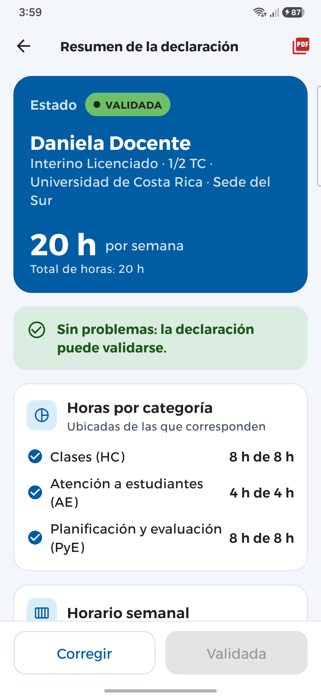

Cuando todo está completo, toque **Validar**. El estado pasa a **Validada**. Si después cambia algo, vuelve a
**Borrador** y hay que validar otra vez.

El ícono del PDF le muestra la declaración en el formulario oficial. Mientras no esté firmada, dice "BORRADOR".

## 9. Firmar y enviar a su superior

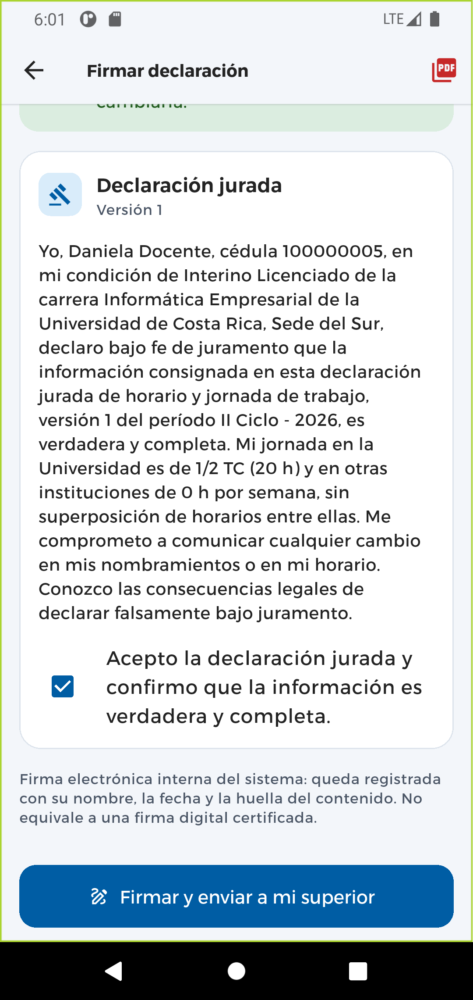

1. Con la declaración validada, toque **Firmar y enviar a mi superior**.
2. Lea el juramento, marque la casilla y firme.
3. La app le confirma *"Declaración firmada y enviada a su superior."* En Inicio, el seguimiento pasa a
   **Superior**.

Una vez firmada **ya no se edita** desde el teléfono. Si el superior o RRHH la devuelven, la corrección se hace
en la web.

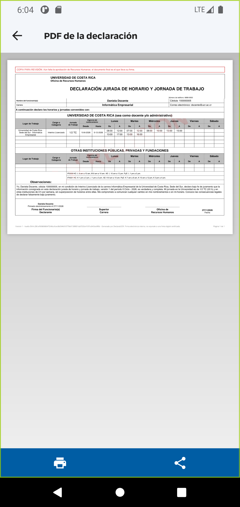

## 10. Zonaje e historial

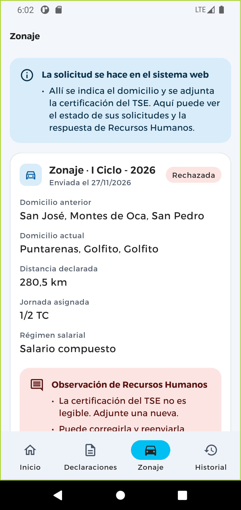

**Zonaje** muestra el estado de sus solicitudes y la respuesta de Recursos Humanos. La solicitud se hace en la
web, porque pide marcar su domicilio en un mapa y adjuntar la certificación del TSE.

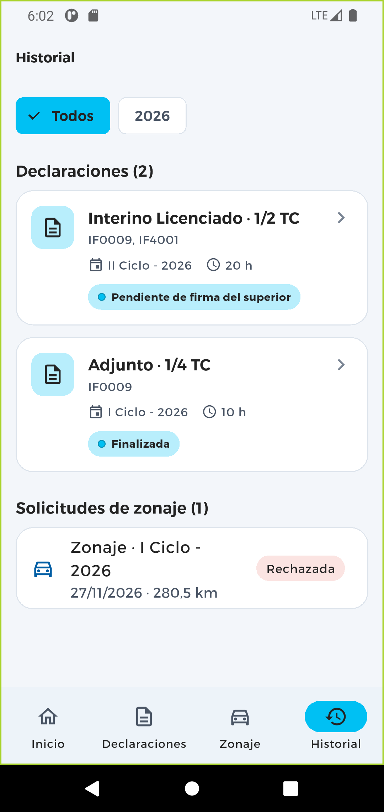

**Historial** reúne sus declaraciones y solicitudes de todos los ciclos, por año.

## 11. Si se va la señal

Arriba aparece una franja: *"Sin conexión: ve lo último guardado en el teléfono. Para guardar cambios necesita
conexión."*

- Puede seguir viendo lo que ya estaba guardado.
- Si toca **Guardar borrador**, la app no guarda y le avisa. **Sus cambios siguen en pantalla**: guárdelos
  cuando vuelva la señal.
- No cierre la app mientras tenga cambios sin guardar y sin señal: eso sí se pierde.

## 12. Cerrar sesión

Toque el círculo con sus iniciales, arriba a la derecha, y luego **Cerrar sesión**.

## 13. Mensajes frecuentes

| Mensaje | Qué significa | Qué hacer |
|---|---|---|
| *La Coordinación de su carrera aún no le asignó cursos en …* | No hay cursos asignados en el período | Consultar con la Coordinación |
| *Ya tiene una declaración en cada período abierto.* | Solo hay una declaración por período | Abrir la que ya tiene desde Declaraciones |
| *Las clases las asigna la Coordinación de su carrera: no se mueven.* | Tocó una clase en la cuadrícula | Ubique otras tareas en las horas libres |
| *Sin conexión. Sus cambios siguen en pantalla…* | No hay internet | Guardar cuando vuelva la señal |
| *El servidor no confirmó el guardado a tiempo…* | La red está lenta | Revisar la conexión y volver a guardar |
| *Esta declaración ya fue firmada y no se edita.* | Ya la firmó | Para corregir, que el superior la devuelva |

---

Los textos de esta guía se revisaron contra el código de la app el 24/11/2026: botones, campos y mensajes
coinciden. Ya usan **«Superior»** en lugar de «Revisor» (P1-03 de la matriz), que llega con la 2.0.0+8. `[COMPLETAR con la 2.0.0+8: cambiar las capturas que muestran «Revisor» (Inicio y Firma) y comparar el resto (son de la 2.0.0+4).]`
